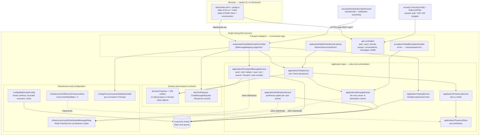

# Architecture — Distributed Chat

Status of this document: **current behaviour is authoritative**, and every
section about the future is explicitly marked *planned*. Nothing described as
planned exists in the code today.

---

## 1. What exists now

A single Spring Boot process that:

- serves a landing page (`/` → `landing.html`), the chat client (`/app` →
  `index.html`) and its static assets,
- authenticates users with email + password (BCrypt), keeps the identity in a
  server-side Spring Security session, and reuses that session principal for the
  WebSocket handshake,
- exposes a REST API (`/api/**`) for auth, users, friends, groups, conversations,
  messages, settings and file uploads,
- accepts STOMP-over-WebSocket connections at `/ws`, authorising every
  conversation subscription by membership and every notification subscription
  by ownership,
- persists users, friendships, conversations, members and roles, messages with
  replies/reactions/pins/attachments/read positions, group join requests,
  invitations, invite links and per-user settings in an embedded H2 file database
  (PostgreSQL mode) with Flyway as the sole schema owner (`ddl-auto: validate`),
- fans out conversation events (`NEW_MESSAGE`, `MESSAGE_EDITED`,
  `MESSAGE_DELETED`, `MESSAGE_REACTED`, `MESSAGE_PINNED`, `READ_UPDATE`,
  `TYPING`) after commit, and live notifications to a private per-user topic,
- applies fixed-window rate limits to login, registration, friend requests and
  message sends (429 + `Retry-After`),
- validates uploads by magic bytes, size and generated storage name rather than
  by the filename or content type the client claimed,
- keeps the browser usable through a dropped socket: STOMP 1.1 heartbeats, a
  silence watchdog, capped exponential reconnect, REST catch-up for everything
  missed, and a REST fallback for composer sends,
- holds live presence in memory by default, with a Redis-backed distributed
  mode (`chat.distributed.enabled`) that moves presence to shared Redis hashes
  and relays every topic frame across instances over Redis Pub/Sub,
- gates what a reader may see about another account: a person's profile card and
  a group's card (roster included) come from two endpoints that decide visibility
  server-side, and one presence policy combines the live registry with each
  account's `Show online status` choice so friends list, search, rosters and
  cards cannot disagree,
- optionally seeds a demo world (ten accounts, groups, messages exercising every
  feature) on startup, but only when `chat.seed.enabled=true` — the bean is not
  in the context otherwise, and a re-run against a seeded database is a no-op.

---

## 2. Diagram



**Dependency direction:** adapters → application → domain/DTO. Nothing points
backwards, so `domain/` contains no Spring import, and `ChatService` knows
nothing about HTTP or WebSocket headers.

---

## 3. Layers and their responsibilities

| Layer | Package | Responsible for | Must not do |
|---|---|---|---|
| Transport adapters | `websocket/`, `api/` | Extract session identity, validate payloads, delegate | Contain business rules, decide destinations |
| Application | `application/` | Chat rules, orchestration, presence, routing decisions | Depend on HTTP/WebSocket types, render anything |
| Domain | `domain/` | The concepts: a message, a user, message type | Depend on Spring or on JSON |
| Contracts | `dto/` | Wire shape + declarative validation | Hold rules that need other objects |
| Infrastructure | `infrastructure/` | Concrete implementations of ports | Leak into the application layer |
| Configuration | `config/` | Broker wiring, executors, handshake, CORS | Contain rules |
| Errors | `exception/` | One consistent failure contract per transport | Leak internals or message bodies |

### Separation that matters most

1. **Session management is separate from message routing.**
   `PresenceStore`/`PresenceService` answer "who exists?"; `MessageRouter`
   answers "where does this go?". Neither has to understand the other's job.
2. **`MessageRouter` owns the wire vocabulary, not every publish.**
   It holds the `/app` and `/user` prefixes that `WebSocketConfig` passes to the
   broker, the destination constants, and the two builders
   (`conversationTopic(id)`, `notificationTopic(userId)`) — so no destination
   string is assembled anywhere else, and `FrontendContractTest` can check the
   browser's copy against one source of truth. It also publishes presence (the
   one frame with no business service behind it) and per-connection errors.
   Conversation and notification frames are published by their own services,
   because those publishes are the after-commit half of a transaction those
   services own; `MessageRouter` could not both hold the routing table and stay
   out of their transaction boundaries.
3. **`PresenceStore` is a port with two implementations.**
   `InMemoryPresenceStore` is the default; `RedisPresenceStore` is selected by
   `chat.distributed.enabled=true` through `@ConditionalOnProperty`, so the
   services never learn which one they got. The same trick keeps
   `DistributedMessageRelay` optional: services ask an
   `ObjectProvider<DistributedMessageRelay>` at publish time and skip the relay
   when the bean is absent, which is why single-node and cluster code paths are
   literally the same code.
4. **Whether a person may be seen online is decided once.**
   `PresencePolicy` combines the connection registry with the account's
   `Show online status` setting, and is the only thing the friends list, the
   search results, a group roster, the chat header and a profile card ask.
   Before it, the setting existed and nothing read it, so five surfaces could
   each have answered differently about the same person. The browser plays the
   same rule: it never renders presence from the raw `/topic/users` list, which
   carries accounts that hid their status — a frame there only triggers a
   debounced re-read of the REST view.
5. **A read that shows somebody else is one endpoint's decision.**
   `ProfileQueryService` answers "who is this to the caller" and never returns an
   email; `ConversationService.getGroupProfile` answers "what may this caller see
   of this group", and whether the roster is in the answer at all. The page draws
   both cards from those reads rather than deciding visibility client-side, which
   is why the group page and the group card cannot drift apart, and why a plain
   member is shown facts instead of a form the server would refuse.

---

## 4. Endpoints and destinations

### Connection

| Item | Value |
|---|---|
| WebSocket endpoint | `/ws` (native WebSocket, no SockJS) |
| Application prefix | `/app` |
| Broker prefixes | `/topic` (topics), `/queue` (point-to-point) |
| User prefix | `/user` |
| Heartbeats | 10 s out / 10 s in, one daemon scheduler thread |
| Allowed origins | `chat.allowed-origins`, default `http://localhost:*` and `http://127.0.0.1:*` (plus dev ports 3000/5173) — never `*` |

### Client → server (STOMP `SEND`)

| Destination | Payload | Effect |
|---|---|---|
| `/app/chat.join` | `{"username":"alice"}` | Registers this connection under a display name |
| `/app/conversations/{id}/send` | `{"content":"hello","replyToId":null,"clientMessageId":"…"}` | Persists a message and fans it out to the conversation topic |
| `/app/conversations/{id}/typing` | `{"typing":true}` | Broadcasts an ephemeral typing hint, throttled to one frame per member per 2 s |

### Server → client (broadcast or directed)

| Destination | Payload | When |
|---|---|---|
| `/topic/users` | `UserPresenceResponse` | Any join, leave, or presence change |
| `/topic/conversations/{id}` | conversation event (`NEW_MESSAGE`, `MESSAGE_EDITED`, `MESSAGE_DELETED`, `MESSAGE_REACTED`, `MESSAGE_PINNED`, `READ_UPDATE`, `TYPING`) | A persisted message changes in a conversation you subscribe to |
| `/topic/notifications/{userId}` | `NotificationDto` | Something that concerns that one user happened: message, mention, reply, friend request/acceptance, group invite, join request/acceptance — and only if their stored preference for that category allows it |
| `/user/queue/errors` | `ErrorResponse` | A failure caused by *this* connection |

Notifications go to a **topic** rather than `/user/queue/…` because
`DistributedMessageRelay` only carries topic destinations between instances;
`StompSubscriptionGuard` is therefore what keeps them private — it refuses the
subscription for any session whose user is not that id. The unguessable UUID in
the path is a convenience, not the authorisation.

### Conversation event envelope

Every event on `/topic/conversations/{id}` is one shape:

```json
{ "event": "READ_UPDATE", "conversationId": "…", "data": { }, "timestamp": "…" }
```

`data` is the full `PersistentMessageResponse` for message-carrying events and a
small map for the two that are not about one row (`READ_UPDATE` carries
`{userId, readAt}`, `TYPING` carries `{userId, username, typing}`). Clients
never have to guess which event they received from the payload's shape, and no
event is published before its transaction commits.

### Message JSON schema

Persisted conversation messages travel as `PersistentMessageResponse` objects
(id, conversation id, sender id/username, content, timestamps, edit/delete/
pin/forward flags, `readByCount`, reply preview, attachment, reaction
aggregates) inside the message-carrying events on
`/topic/conversations/{id}`. `sender`, ids, and timestamps are **always
assigned by the server**.

Presence payload:

```json
{
  "event": "JOIN",
  "username": "alice",
  "users": ["alice", "bob"],
  "timestamp": "2026-10-19T07:52:06.862Z"
}
```

One presence message carries both the cause and the complete sorted list, so a
client cannot be left with a stale list after a lost frame.

### Error codes

One `ErrorResponse{code,message}` shape serves both transports; REST adds the
HTTP status in `GlobalExceptionHandler.statusFor`.

| Code | HTTP | Meaning |
|---|---|---|
| `INVALID_USERNAME` | 400 | Blank, too long, or contains control characters |
| `USERNAME_TAKEN` | 409 | Another live connection already holds the name |
| `INVALID_MESSAGE` | 400 | Blank or over 2000 characters |
| `INVALID_REACTION` | 400 | Not a recognised emoji, or too long |
| `INVALID_UPLOAD` | 400 | Empty, oversized, or the bytes are not an allowed type |
| `INVALID_COMMAND` | 400 | The request is well-formed but the operation is not allowed here |
| `UNAUTHORIZED` / `BAD_CREDENTIALS` | 401 | No session, or the password did not match |
| `FORBIDDEN` / `NOT_MEMBER` / `USER_BLOCKED` | 403 | Authenticated, but not permitted for this conversation or group |
| `USER_NOT_FOUND` / `CONVERSATION_NOT_FOUND` / `MESSAGE_NOT_FOUND` / `REQUEST_NOT_FOUND` | 404 | The target does not exist (or was removed) |
| `DUPLICATE_USERNAME` / `DUPLICATE_EMAIL` / `ALREADY_FRIENDS` / `CANNOT_FRIEND_SELF` / `REQUEST_ALREADY_EXISTS` | 409 | The state you asked to create already exists |
| `RATE_LIMITED` | 429 | Budget exhausted; carries `Retry-After` |
| `INTERNAL_ERROR` | 500 | A server bug; details go to the log only |

The code identifies the *concept* that was wrong, whichever layer noticed it:
the validation handler maps the offending field onto the right code, so a bad
username never comes back disguised as a bad message. Not-found and not-a-member
deliberately share the refusal for resources the caller may not see, so the API
does not confirm the existence of a conversation to an outsider.

---

## 5. Concurrency — stated honestly

Three different claims are often blurred together. Only the first two are true
here.

### 5.1 Concurrent connections — **yes**

Many browsers can hold a socket to this process at once. Nothing in the code
assumes one user at a time; presence is a `ConcurrentHashMap`, not a field.

### 5.2 Multithreaded processing — **yes, bounded**

- STOMP frames arrive on a **bounded inbound pool** (core 4, max 16, queue 500).
- Delivery runs on a **bounded outbound pool** (core 4, max 16, queue 500).
- Both use `CallerRunsPolicy`: when the pool and its queue are both full, the
  caller runs the task itself, which slows the reader down instead of dropping
  work or creating threads without limit.
- **There is no thread-per-message.** A connection does not get a thread for
  each message; tasks are handed to the shared pools.

Configured limits:

| Setting | Default | Purpose |
|---|---|---|
| `chat.inbound.*` | 4 / 16 / 500 | Frame processing capacity |
| `chat.outbound.*` | 4 / 16 / 500 | Delivery capacity |
| `chat.send-time-limit-ms` | 10000 | A send blocked longer than this closes the slow session |
| `chat.send-buffer-limit-bytes` | 524288 | Per-session outbound buffer ceiling |
| `chat.max-inbound-frame-bytes` | 65536 | Transport-level cap on one inbound frame |
| Message length | 2000 chars | Application-level content limit |

A slow client cannot stall the others: it exceeds the time or buffer limit and
is disconnected rather than allowed to hold an outbound thread.

### 5.3 Multi-instance — **yes for events, no for limits**

With `chat.distributed.enabled=true`:

- **Presence** lives in Redis (`RedisPresenceStore`), so every instance answers
  "who is online" from the same data and a name claim is atomic across the
  cluster (`HSETNX`). Entries are cleared when a session disconnects; there is
  no TTL yet, so a process that is killed leaves its users marked online until
  it restarts (see §7.3).
- **Every topic frame crosses instances.** `DistributedMessageRelay` serialises
  `{instanceId, destination, payload}` onto the Redis Pub/Sub channel
  `chat:cluster:events`; each node subscribes, discards envelopes it originated
  (its own broker already delivered them) and replays the rest into its local
  broker. Conversation events, typing hints, notifications and presence
  broadcasts all take that path, so a client on node B receives what node A
  published — which is why notifications use a per-user *topic* instead of
  `/user/queue`.
- **Payloads are complete, not deltas.** A presence frame carries the whole
  sorted online list read from the shared store, so replaying it on another node
  is correct rather than a partial view of the publishing node.

What still does **not** cross instances: the fixed-window rate-limit counters,
the DM-pair striped locks, and the in-process broker's own subscription table
(relay is a replication layer on top of it, not a shared broker). A message
delivered by both the direct send and the relay is deduplicated client-side by
message id.

The relay is covered by `DistributedMessageRelayTest` (two relay nodes with a
mocked Redis template, asserting the envelope contract and self-echo
suppression) and `CrossInstanceFanoutTest` (every event type reaches the relay
with the right destination). **No run against a real Redis has been performed in
this environment** — there is no Redis server on the machine — so the live
two-node behaviour is reasoned-about and contract-tested, not observed.

### 5.4 Why the rules are safe

The only mutable shared state is the presence store, and uniqueness is
enforced by a single **atomic `putIfAbsent`** — not by a lock held across
network I/O:

```java
if (bySession.putIfAbsent(sessionId, user) == null) {
    if (byName.putIfAbsent(nameKey, user) == null) {
        return user;          // exactly one winner
    }
    bySession.remove(sessionId);
}
```

Two threads racing with the same name cannot both succeed: `putIfAbsent` is
atomic in the JDK. No lock is taken anywhere on this path, so a slow client
cannot make another client wait for a presence update. `DuplicateUsernameConcurrencyTest`
releases 32 threads at a time (including a mixed-case variant) and asserts
exactly one registration succeeds.

`ChatService` is stateless; each call works from its arguments. An immutable
`ChatMessage` is safe to hand to several threads when it is delivered to more
than one recipient.

What is **not** claimed: message ordering across the pool is not guaranteed
per session, and the design does not depend on it. Nothing in the rules
requires "message 2 must be processed strictly after message 1".

### 5.5 Database-level concurrency — **yes, tested**

Presence is not the only shared state any more: friendships, group membership
and messages are written concurrently, and the check-then-write races against
the unique constraints are closed deliberately:

| Race | Defence |
|---|---|
| Duplicate idempotent send (same `clientMessageId` twice concurrently) | `SELECT … FOR UPDATE` on the conversation row before the clientId pre-check + `uq_msg_client_id` |
| Two admins adding the same member / join-request accepted while being added | Conversation-row or request-row pessimistic lock + `uq_conv_member`, insert guarded by existence check |
| Double-accept of a join request or group invitation | Lock the request/invitation row first; losers read status ACCEPTED and get `INVALID_COMMAND`; fixed lock order (request → group) prevents deadlock |
| Reaction toggle race | `SELECT … FOR UPDATE` on the message row + `uq_message_reaction` |
| Simultaneous DM creation in both directions | JVM striped locks (64 stripes, sorted pair hash) around a committed transaction + unique conversation key |
| Cross-node correctness | Every above defence is single-node; multi-instance needs DB-level arbitration (already provided by the unique constraints — the loser currently surfaces as 409/500) |

Broadcasts are published only **after** the DB transaction commits
(`TransactionSynchronizationManager` after-commit hook), so a client can never
see a message the database rejected. `ConcurrencyRaceTest` releases latched
thread pools against each scenario and asserts the surviving row count.

---

## 6. Security — what the code does, and what it does not

### Implemented

| Requirement | How |
|---|---|
| Password storage | BCrypt (`spring-security-crypto`) — never plaintext, never reversible |
| Sessions | Server-side Spring Security session; `changeSessionId()` on login (session-fixation defence); cookie is HttpOnly, SameSite=Lax, `Secure` behind `COOKIE_SECURE` |
| Backend authorization | Every REST controller resolves the user from the session principal, never from the request body; services re-check membership/role before reads and writes (IDOR and privilege-escalation paths are covered by `WebSocketSecurityIntegrationTest` and the controller integration tests) |
| WebSocket subscription auth | `/topic/conversations/{id}` subscriptions are intercepted and checked against the member table; `/topic/notifications/{userId}` is refused for any session that is not that user; `/topic/users` needs an authenticated session. Anonymous or non-member subscriptions are refused (403) |
| Presence is a preference, enforced at the source | `PresencePolicy` returns "online" only when the account is connected **and** has not hidden its status, and every read that displays presence uses it — friends list, user search, group roster, profile card, chat header. A hidden account reads as hidden, not as offline (`OnlineVisibilityTest`) |
| Profile cards leak nothing they are not for | `GET /api/users/{id}` returns display name, avatar, bio, join date, presence-as-permitted, the caller's friendship status and two counts. There is no email in the payload, a deactivated account is indistinguishable from a missing one, and mutual friends and shared groups are **counted, never listed** — otherwise a public profile becomes a way to enumerate somebody's social graph (`UserProfileIntegrationTest`) |
| A group's roster belongs to its members | `GET /api/conversations/groups/{id}/profile` answers members with the roster and roles, a stranger on a public group with only the facts discovery already advertises and an empty roster, and a private group you are not in with 403 `NOT_MEMBER` — without echoing its title. Discovery itself selects `isPrivate = false`, so a private group's name and description are never advertising space (`GroupProfileIntegrationTest`) |
| Sender cannot be spoofed | `senderId` comes from the connection's `Principal`, never from the payload |
| Upload validation | Type decided by sniffing magic bytes against an allow-list (PNG, JPEG, GIF, WebP, PDF), never by the client's filename or `Content-Type`; per-file size cap applied after the bytes are read; stored under a generated `<prefix>_<uuid>.<ext>` name, with the resolved path re-checked against the upload root; `/uploads/**` requires a session and is served from the same directory the service writes to |
| Attachment integrity | The reference stored on the message row is the URL the server generated; a client cannot point a message at an arbitrary path |
| Forwarding is checked twice | A forward requires membership in the **source** and in the **destination**, so a member of B cannot pull content out of a conversation A they left |
| Capability tokens | Invite links use a 128-bit `SecureRandom` token carried only in POST bodies, so it never lands in a URL, an access log, or a `Referer`; every unusable state (expired, exhausted, revoked, blocked, already a member) returns the same refusal |
| Notification gating | Preferences are read from the database at publish time, not trusted from the client, and a notification that fails to publish never fails the business write that caused it |
| Rate limiting | Fixed-window limiter (`security/RateLimitFilter` + `RateLimiter`): login and register per IP, friend requests per user, message sends per sender inside `PersistentMessageService` (one choke point for REST **and** STOMP). Refusals return 429 + `Retry-After`; retries of already-persisted sends never consume budget |
| Response headers | Strict CSP with no `unsafe-*` (verified against the client's actual needs), `X-Frame-Options: DENY`, `X-Content-Type-Options: nosniff`, `Referrer-Policy: same-origin` |
| SQL injection | Spring Data JPA parameter binding throughout; no string-built SQL |
| XSS | Output: `app.js` renders user content with `textContent` only (a contract test fails the build if an HTML sink appears). Input: length and control-character validation; CSP as second layer |
| CSRF | Spring's CSRF filter is disabled because the API is cookie-session based; the mitigation is SameSite=Lax (cross-site POSTs arrive without the session cookie). A same-origin deployment (`/app` and `/api` share one origin) keeps `fetch` unauthenticated-token-free. See limitations |
| Input validation | Bean Validation on DTOs **and** re-checks in the application services (defence in depth, so a future adapter that skips validation cannot bypass the rules) |
| Message length limit | 2000 chars, enforced in both places, asserted by tests |
| Restricted origins | Explicit allow-list (`chat.allowed-origins`); never `*` — for both the WebSocket handshake and HTTP CORS |
| Direct chats stay direct | A direct conversation only fans out to `/topic/conversations/{id}` of its two members; membership is checked server-side |
| Private content is not logged | Only lifecycle events are logged; no message bodies, no password hashes, no tokens |
| Error contract | One `ErrorResponse{code,message}` shape per transport; HTTP statuses mapped by concept (401/403/404/409/429/400), internals never leaked |

Origin checking deserves a precise note. Spring's `OriginHandshakeInterceptor`
allows a request when either (a) the `Origin` header matches the request's own
`Host`, or (b) the origin is in the configured allow-list. Observed directly
against a running server:

```
(no Origin header)       -> 101   same-origin / non-browser client
http://localhost:8080    -> 101   on the allow-list
http://localhost:8090    -> 101   same-origin as the Host header
https://evil.example     -> 403   cross-origin and not listed
null                     -> 403   sandboxed / opaque origin
```

So the endpoint cannot be opened from an arbitrary third-party site, while a
page served from the same host:port always works — including when the port is
changed, which needs no configuration change.

### Known limitations (audited, deliberately un-fixed)

- **CSRF relies on SameSite, not a token.** A browser that ignores SameSite
  (very old ones) could forge a cross-site POST. Acceptable for this deployment
  model; enabling Spring's CSRF support would require surfacing the token to
  the SPA.
- **Presence join names are self-declared.** `/app/chat.join` still accepts a
  username in the payload. The authenticated principal gates the WebSocket
  session, but the presence display name is not yet bound to it.
- **Rate limits are per-node.** The fixed-window counters live in this JVM's
  memory. Multi-instance deployments need a shared counter (Redis `INCR` +
  `EXPIRE`) — same upgrade path as presence (§7.3).
- **Idempotent DM-pair creation is per-node.** `getOrCreateDirect` uses JVM
  striped locks plus a DB unique constraint; correctness holds within one
  instance and degrades to a caught constraint violation across instances.
- **Mutual simultaneous friend requests** (A→B and B→A in the same instant,
  neither pending yet) can surface a 500 from the `uq_friendship` constraint.
  State stays consistent and a retry reports ALREADY_FRIENDS, but the mapping
  is imperfect.
- **Invite-link joins have no dedicated budget.** They are gated by
  authentication, the token itself, blocking, membership and the link's own
  `maxUses`, but they are not behind a separate per-IP counter — a member who
  has registered many accounts could spend a link they know about. Adding a
  `RATE_LIMIT_INVITE_JOINS` window is the intended fix, not implemented.
- **Notifications are not replayed.** They are deliberately not stored, so a
  client that was offline misses the frame and recovers by reading unread
  counts and pending-request lists on its next load. There is no notification
  inbox endpoint.
- **Ephemeral frames are not replayed either.** Typing hints and presence
  deltas exist only while the socket is up; after a reconnect the client
  refetches conversations and messages, and the next presence frame carries the
  full list, so nothing has to be replayed — but a typing indicator that was in
  flight is simply gone.
- **Distributed presence has no expiry.** `RedisPresenceStore` keys are plain
  hashes with no TTL and there is no sweep job, so a killed instance's users
  remain online and keep their names until that instance restarts. Normal
  disconnects (and silent peers noticed by the heartbeat watchdog) do clean up.
- **Databases older than Flyway ownership still differ from the migrations.**
  Before Flyway became the sole schema owner, Hibernate's `ddl-auto` created these
  tables, and it mapped `@Enumerated(EnumType.STRING)` to a native H2 `ENUM` whose
  permitted value list froze at creation time. Flyway baselines at V1 on a
  non-empty schema and never replays it, and `ddl-auto: validate` compares the
  column *type*, not the value list — so promoting a moderator failed with
  `Value not permitted for column ('MEMBER', 'OWNER'): MODERATOR` until V6 widened
  those five columns. The same Hibernate-created tables also lack the
  `ON DELETE CASCADE` the migrations declare, so a manual `delete from users`
  leaves dangling child rows; the application never hard-deletes users, which is
  why nothing has caught it. A database created from V1 onwards has neither.
- **Transport security (TLS) is external.** Run behind a TLS-terminating proxy
  or enable Tomcat's HTTPS connector, and set `COOKIE_SECURE=true`.

---

## 7. Path to a distributed deployment

Each item separates **now** from **planned**. Nothing in the planned column is
started.

### 7.1 Load balancer

| Now | Planned |
|---|---|
| One process, addressed directly at `:8080` | HTTP load balancer (nginx / ALB) in front of N instances |
| | The `/ws` upgrade must pass through the balancer's WebSocket support |
| | Health check against `/api/health` |

A load balancer alone is **not sufficient** — see §7.2, because the broker is
in-process.

### 7.2 External message broker

| Now | Planned |
|---|---|
| `enableSimpleBroker("/topic","/queue")` — subscriptions live in this JVM, with `DistributedMessageRelay` re-publishing every topic frame it receives from Redis into that local broker | Replace with `enableStompBrokerRelay(...)` pointing at RabbitMQ (STOMP plugin) or ActiveMQ, so subscription state itself is shared |
| Live frames do reach another instance when `chat.distributed.enabled=true`, through an application-level relay | No application-level replication step: one logical broker, so `*`-broadcasts, per-user queues and receipts behave identically on every node |
| The relay is at-least-once with no persistence: a frame published while every node is reconnecting is lost (history is recovered from the DB, ephemeral hints are not) | Broker-side persistence/acknowledgement, so a frame survives a node being briefly down |

The relay is what makes scaling out usable today; the external broker is what
would make it *simpler* — it removes the per-node fan-out step, the self-echo
filter, and the reason notifications had to be modelled as topics rather than
`/user/queue`.

**Why session affinity alone is not enough.** Sticky sessions keep a user's
socket on one instance, which does fix delivery *to that user* if every message
for them is produced by the instance holding their socket. It does not help when
instance A must broadcast to users on instance B — that is exactly the case the
Redis relay covers now, and the case a shared broker would cover without any
application code. With an external broker there is less need for affinity,
though retaining it keeps `/user/**` translation local and avoids
cross-instance session lookup.

### 7.3 Presence that survives multiple instances

| Now | Planned |
|---|---|
| `RedisPresenceStore` when `chat.distributed.enabled=true`: two hashes (`chat:presence:users` by lowercased name, `chat:presence:sessions` by session id), name claims made atomic by `HSETNX` (`putIfAbsent`); two `ConcurrentHashMap`s in one JVM otherwise | The same, with the in-memory mode kept only for single-node development |
| Entries are deleted by `unregister` on `SessionDisconnectEvent`, which the STOMP heartbeat watchdog also triggers for a *peer* that went silent | TTL on the presence entries (hash-field expiry, or `SET NX` + `EXPIRE` keys with an index hash), so an instance that dies takes its own names with it |
| Lost on restart in in-memory mode; in Redis mode a clean shutdown clears names but a crash leaves them | Survives restart without stale registrations |
| Presence changes are relayed to every node as a complete snapshot | Fan-out through the shared broker instead of the application-level relay |

Consistency points that still deserve attention:

- **Authority.** One store decides uniqueness: `HSETNX` is atomic in Redis, so
  two instances cannot both admit "alice" — but the loser currently surfaces as
  `USERNAME_TAKEN` rather than a re-attachment of the same user's second tab.
- **Staleness — open gap.** There is no TTL anywhere in
  `com.example.chat.infrastructure.redis`. A JVM that is killed never reaches
  `unregister`, so its users stay listed as online and hold their names until
  that instance restarts and re-registers them. Everything else in this section
  assumes that is fixed first.
- **Read-your-writes.** A join reads back from the shared store, so a client
  sees itself immediately — worth re-checking if the store is ever cached.

### 7.4 Durability, acknowledgements, offline delivery

| Now | Planned |
|---|---|
| Messages are persisted before broadcast; events are published only after commit | STOMP `ACK` frames so delivery is confirmed per message |
| Sends are idempotent on `clientMessageId` — a retry never duplicates a row | Explicit `NACK` + redelivery policy for failed sends |
| The client negotiates STOMP 1.1 heartbeats, watches for inbound silence, reconnects with capped exponential backoff (1 s–15 s) and then refetches conversations and history over REST | Offline inbox / per-user queue, drained on reconnect, instead of a full refetch |
| The composer falls back to `POST /api/conversations/{id}/messages` while the socket is down, so a send does not wait for the reconnect | |
| Client dedupes by message id when an event races the REST response or a relay replay | |
| Notifications are not stored; an offline client infers the state from unread counts and pending-request lists | A stored notification inbox with a read/clear API |

Message IDs are already server-generated and unique, which is the precondition
for idempotent writes.

### 7.5 Persistent storage

| Now | Planned |
|---|---|
| Relational store: embedded H2 in PostgreSQL mode, Flyway V1–V6 as sole schema owner, `ddl-auto: validate` (missing or extra tables and columns fail boot; permitted-value drift inside a native ENUM column does not — see §6) | Managed PostgreSQL for real deployments |
| `GET /api/conversations/{id}/messages` history behind session auth | Retention and privacy policy for stored content |
| Write path idempotent on `clientMessageId` | Online schema migrations with expansion/contraction phases |
| Uploads on the local filesystem under `app.upload.dir`, served from that same directory | Object storage (S3-compatible) with signed URLs; the `.meta` sidecar that records the advertised filename would move with it |

### 7.6 Authentication and authorization

| Now | Planned |
|---|---|
| Email + BCrypt password → server-side session; the WebSocket handshake reuses the same session principal | SSO / signed token carried at handshake time for stateless scale-out |
| The handshake prefers a real authenticated principal (`AnonymousHandshakeHandler` seam, now exercised) | Authority mapping for administrative actions beyond owner/moderator |
| Conversation subscriptions authorized by membership, notification subscriptions by ownership; REST handlers check membership/role per call | |
| Group roles are `OWNER` / `MODERATOR` / `MEMBER`, with the owner the only one who can change roles | Finer-grained permissions (who may pin, invite, or read stats) if the product needs them |
| Rate limits per identity for messages and friend requests, per IP for auth endpoints | Shared (Redis) counters so limits hold across instances |

### 7.7 Monitoring and health

| Now | Planned |
|---|---|
| Hand-written `GET /api/health` returning `status`, `onlineUsers`, `timestamp` | Spring Boot Actuator (`/actuator/health`, `/actuator/metrics`) behind auth |
| Broker stats logged once a minute by Spring | Metrics: active sessions, messages in/out, slow-client disconnects, rejection counts by error code |
| | Distributed tracing across instances; alerting on send-limit disconnects |
| | Log redaction policy formalised — today only lifecycle events are logged |

`/api/health` is intentionally tiny so it stays usable as a load-balancer probe.

### 7.8 Horizontal scaling — the order to do it in

1. TLS termination (and `COOKIE_SECURE=true`); optionally a CSRF token for the SPA.
2. Presence expiry (TTL or a shutdown sweep) — otherwise a crashed node holds
   names hostage before anything else is even tried.
3. Load balancer; verify WebSocket upgrades pass through. Safe to try now
   because `chat.distributed.enabled` already relays events and shares presence.
4. Shared rate-limit counters; let DB unique constraints arbitrate cross-node
   races with clean 409s.
5. External broker (`enableStompBrokerRelay`) to retire the application-level
   relay, and with it the self-echo filter and the topic-shaped notifications.
6. Metrics and alerting.

The order changed when the relay landed: step 3 used to be pointless before an
external broker, because scaling out without any cross-node fan-out silently
fragments the chat. It is now merely insufficient rather than broken.

---

## 8. Key decisions (ADR style)

| # | Decision | Why |
|---|---|---|
| 1 | Spring Boot 3.5.16, Java 21, Maven wrapper | Current LTS + pinned build tool; wrapper removes the "install Maven first" step |
| 2 | Native WebSocket only, no SockJS | Every target browser supports WebSocket; removing it drops a protocol layer and a dependency |
| 3 | In-process simple broker for MVP | No infrastructure to run; the boundary is one method call (`enableSimpleBroker` → `enableStompBrokerRelay`) |
| 4 | `/queue` is a broker prefix | Spring translates `/user/queue/x` into `/queue/x-user<sessionId>`; without `/queue` in the broker, per-connection error replies are undeliverable |
| 5 | Per-connection `Principal` at handshake | Spring only registers a session for `/user/**` delivery when a principal exists; this is also the authentication seam |
| 6 | Join/leave are presence events, not chat messages | Presence travels on `/topic/users`; conversation content on `/topic/conversations/{id}`, so a client never has to filter system notices out of history |
| 7 | Presence message carries the full list | A client cannot be left stale by a single lost frame; no delta replay logic |
| 8 | Atomic `putIfAbsent` for uniqueness | Lock-free correctness: no lock is held while anything talks to the network |
| 9 | Bounded pools with `CallerRunsPolicy` | Overload becomes back-pressure instead of unbounded threads or dropped messages |
| 10 | DTO bean validation **and** service re-check | Documented defence in depth; keeps the rules correct if a second adapter is added |
| 11 | Error codes name the concept, not the layer | A bad username must not be reported as a bad message just because the DTO layer caught it |
| 12 | Session-based Spring Security for the REST API | Cookie sessions with BCrypt-hashed passwords; the WebSocket handshake reuses the same session principal |
| 13 | Hand-rolled minimal STOMP client in `app.js` | The demo works offline and needs no build step or third-party JS |
| 14 | `textContent` only, enforced by a test | Prevents a message body from becoming markup in a reader's browser |
| 15 | Pessimistic row locks behind every check-then-write, with unique constraints as the final arbiter | Closes duplicate-member/double-accept/reaction races; proven by latched-thread tests |
| 16 | Conversation events published only after the DB commit | A client can never see a message the database rejected ("persist before confirming") |
| 17 | Fixed-window rate limiter, per sender inside `PersistentMessageService` | One choke point covers REST and STOMP sends; retries of persisted sends never consume budget |
| 18 | Strict CSP with no `unsafe-*` | Compatible with the textContent-only client by construction; blocks injected script even if XSS slipped through |
| 19 | Flyway as sole schema owner, `ddl-auto: validate` | Structural drift (a table or column the entity expects but the migrations do not create) fails boot loudly. It cannot see a column whose *permitted values* shrank — that needed V6, see §6 |
| 20 | `changeSessionId()` on login | Session-fixation defence without a second cookie |
| 21 | Typing hints throttled server-side (one per member per 2 s) rather than per keystroke | The frame is a hint, so the cost of a second subscriber in a large group must not scale with typing speed |
| 22 | Read state stored as one position per member (`lastReadAt` + `lastReadMessageId`), not a row per message | A per-message receipt table grows with every message × every member; one position answers both `readByCount` and `unreadCount` |
| 23 | Search and pinning are query-side, not a denormalised index | PostgreSQL/H2 `LIKE` over the conversation's own rows is enough at this scale; `uq`-style constraints keep pins honest |
| 24 | Forwarding re-checked for source membership | The destination check is implicit in `sendMessage`; without the source check, leaving a group would not stop you draining its history into another conversation |
| 25 | Attachment type from magic bytes, filename from the server, size checked after reading | A client controls its own filename and `Content-Type`; neither is evidence of what the bytes are |
| 26 | `multipart.max-file-size` set above the application cap, which then re-checks | Spring's 1 MB default would reject legitimate images before the service that owns the real limit ever sees the bytes |
| 27 | Notifications on a guarded per-user **topic**, published after commit | `/user/queue/**` is not carried by the relay; the guard, not the UUID in the path, is what keeps them private |
| 28 | Notifications are not persisted | They point at rows that already exist; a second copy of the truth would drift and give offline clients a backlog to reconcile |
| 29 | Invite-link token in the POST body, 128-bit `SecureRandom`, uniform refusal for every unusable state | URLs reach access logs and `Referer`; distinguishing "expired" from "revoked" from "you are blocked" turns the endpoint into an oracle about the group |
| 30 | Pessimistic lock read-through for token redemption (`findGroupIdByToken` before the locked load) | Hibernate will not refresh an entity already in the persistence context, so a locked JPQL read on the same id returns the stale copy and two requests can spend one link |
| 31 | Cross-instance relay is destination-agnostic and drops only its own echo | Adding an event type needs no relay change — but forgetting to publish to the relay silently splits the cluster, which is what `CrossInstanceFanoutTest` exists to prevent |
| 32 | Client reconnect = heartbeat watchdog → capped backoff → REST catch-up → dedupe by message id | Recovers missed durable frames without a per-user queue, and tolerates at-least-once relay delivery without showing duplicates |
| 33 | In-app confirmation dialog instead of `window.confirm` | The native dialog cannot be styled, is announced with the page title rather than the question, and steals focus; a dialog that resolves only on the confirm button makes "cancelled" and "dismissed" the same answer |
| 34 | `/uploads/**` location derived from `app.upload.dir` | The write path and the read path must be one setting; a hardcoded location stores files where nothing serves them |
| 35 | Demo data behind `chat.seed.enabled`, absent by default | `@ConditionalOnProperty` keeps the seeder out of the context unless asked for, so there is no "we shipped demo users to production" path — a deployment that never sets the flag cannot run the code |
| 36 | The seeder writes through the services, never SQL | Registration gets BCrypt hashing, paired friendship rows, membership roles, after-commit broadcasts and the per-sender rate budget for free; raw SQL produces a database that looks right and behaves wrong |
| 37 | One transaction around the whole seed | The guard answers "already seeded?" from a single account, so half-written rows would make every later run skip and leave the world permanently unfinished — proven by `DataSeederAtomicityTest` |
| 38 | Repair pre-Flyway schema drift in a forward migration (V6) | Developers whose databases were created by `ddl-auto` keep their data and get a working app; telling them to delete their databases would hide the defect instead of fixing it |
| 39 | One `PresencePolicy` decides displayable presence | `onlineVisibility` was a setting nothing read. Combining the registry lookup with the account's choice in one service is what keeps five surfaces from disagreeing about the same person, and keeps a future sixth surface from getting it wrong by accident |
| 40 | The client treats a `/topic/users` frame as "something changed", never as the answer | The frame carries the raw connected list, accounts that hid their status included. Rendering it would leak precisely what the setting exists to withhold, so the frame only schedules a debounced re-read of the REST view, which is already the authority |
| 41 | The group page and the group card read the same profile endpoint | Two endpoints mean two visibility rules that can drift; one read means the roster a member sees on the page is the same roster the card shows, and the server decides both. It also turned two calls (details + members) into one |
| 42 | Cards count circles rather than listing them | A profile that listed friends or group members would make a public card into an enumeration tool for somebody else's contacts; two integers answer "how do we know each other" without exposing anyone who did not choose to be seen |

---

## 9. Test strategy

| Level | Covers |
|---|---|
| Unit (`ChatServiceTest`) | Presence rules: join validation, duplicate names, rejoin, leave cleanup, error codes |
| Unit (`AuthServiceTest`, `FriendServiceTest`, `ConversationServiceTest`, `PersistentMessageServiceTest`, `GroupModerationTest`, `ConversationOwnershipTransferTest`) | Application rules: credentials, friendship state machine, membership/roles, idempotent sends, reactions, blocking, ownership transfer |
| Unit (`RateLimiterTest`) | Fixed-window budgets, rollover, `Retry-After`, key isolation, disabled-mode, and a 16-thread test proving concurrent traffic shares one budget atomically |
| Concurrency (`DistributedConcurrencyTest`) | Racing threads claiming a presence name, including mixed case |
| Concurrency (`ConcurrencyRaceTest`) | Latched thread pools against each check-then-write race in §5.5 — idempotent sends, competing joins, double-accepts, reaction toggles, DM creation — asserting the surviving row counts |
| Unit (`InMemoryPresenceStoreTest`) | The port's contract: atomicity, lookup, removal |
| Contract (`FrontendContractTest`) | `app.js` destinations match `MessageRouter`; no HTML sink; page stays zoomable; loading vs empty states exist; the modal is an accessible dialog; the profile chip opens settings and the settings page has a phone-only way back; a person row and a group row each open their card, and the card only shows what the endpoint dares to; every destructive call is preceded by a confirmation |
| Integration (`ChatWebSocketIntegrationTest`) | Real sockets, 2–3 simultaneous clients: presence fan-out, duplicate-name refusal, oversized input, disconnect |
| Integration (`WebSocketSecurityIntegrationTest`) | Unauthorized connections and non-member subscriptions refused; delivery only to authorized recipients |
| Integration (`RateLimitIntegrationTest`) | Real HTTP: 429 + `RATE_LIMITED` + `Retry-After` on exhausted login/friend/message budgets; reads unaffected |
| Integration (`SessionHardeningIntegrationTest`) | Cookie HttpOnly/SameSite, session id rotation on login, CSP/X-Frame-Options/nosniff headers present |
| Integration (`HealthEndpointIntegrationTest`, `FriendControllerIntegrationTest`, `FullE2EChatJourneyTest`) | The REST surface: health, friend requests, register → friend → chat journey |
| Integration (`LandingPageIntegrationTest`) | `/` serves the landing page, `/app` serves the client, every marketing button resolves to a real route, claimed security features are actually enforced |
| Integration (`UploadServingTest`) | The application boots on a non-default `app.upload.dir` and a stored upload is served back over `/uploads/**`; anonymous and traversing reads are refused — the write path and the read path must stay one setting |
| Integration (`DataSeederTest`, `DataSeederAtomicityTest`) | The optional demo world boots on a private in-memory database and is actually usable: all ten accounts log in, the friendship graph and the moderation surface (moderator, join request, invitation, invite link, block) exist, the threads carry a pin, forward, reply, edit, soft delete and read receipt, preferences differ per account, and a second run changes nothing — plus a forced mid-seed failure proving nothing is left behind for the "already seeded" guard to mistake for success |
| Engagement (`TypingServiceTest`, `ReadReceiptTest`, `PinnedMessageTest`, `MessageSearchTest`, `MessageForwardingTest`, `MessageAttachmentTest`) | The rules behind each Phase-4 feature: throttled ephemeral frames, per-member read positions, pin permissions, member-scoped search, dual membership checks on forwards, attachment validation |
| Groups (`GroupInviteLinkTest`, `GroupInviteLinkRestTest`) | 20 application-level link rules (entropy, expiry, use count, revoke, blocking, uniform refusal) plus 7 HTTP-surface tests for routing and status codes |
| Notifications (`NotificationIntegrationTest`) | 13 cases over real STOMP sessions: every category reaches the right private topic, preference switches suppress it, and no other session can subscribe |
| Profiles & presence (`UserProfileIntegrationTest`, `GroupProfileIntegrationTest`, `OnlineVisibilityTest`) | 24 cases over the two card endpoints: what the owner, a plain member, a stranger, a pending requester and a blocked user are each allowed to see; that no email ever leaves and a deactivated account reads as missing; that discovery advertises public groups only; and that hiding online status is honoured on all four surfaces that display it rather than reported as offline |
| Distributed (`DistributedMessageRelayTest`, `CrossInstanceFanoutTest`) | The Redis envelope contract between two relay nodes (replay, self-echo suppression, malformed envelopes ignored) and, with a mocked relay, that every event type a user can cause is handed to it with the correct destination |

`ChatWebSocketIntegrationTest` asserts negatively as well as positively: a
refused duplicate join must publish **no** presence frame — a test that would
pass trivially if refusals were indistinguishable from successful joins.
`CrossInstanceFanoutTest` does the same for the relay: `verifyNoInteractions`
would fail a feature that persists correctly but never crosses nodes, which is
the failure mode a distributed deployment actually exhibits.

Run everything with `./mvnw.cmd test` (245 tests across 38 classes, all against a
throwaway in-memory database; no external services required — the distributed
tests mock Redis rather than needing a server, and `DataSeederTest` overrides the
datasource URL so its ten seeded accounts cannot leak into the database the rest
of the suite shares).
