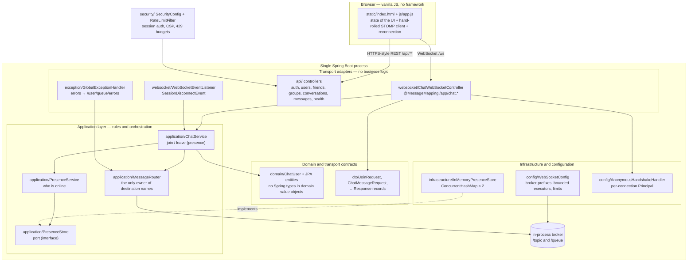

# Architecture — Distributed Chat

Status of this document: **current behaviour is authoritative**, and every
section about the future is explicitly marked *planned*. Nothing described as
planned exists in the code today.

---

## 1. What exists now

A single Spring Boot process that:

- serves a landing page (`/` → `landing.html`), the chat client (`/app` →
  `index.html`) and its static assets,
- authenticates users with email + password (BCrypt), keeps the identity in a
  server-side Spring Security session, and reuses that session principal for the
  WebSocket handshake,
- exposes a REST API (`/api/**`) for auth, users, friends, groups, conversations,
  messages, settings and file uploads,
- accepts STOMP-over-WebSocket connections at `/ws`, authorising every
  conversation subscription by membership,
- persists users, friendships, conversations, messages, reactions and group
  state in an embedded H2 file database (PostgreSQL mode) with Flyway as the sole
  schema owner (`ddl-auto: validate`),
- applies fixed-window rate limits to login, registration, friend requests and
  message sends (429 + `Retry-After`),
- holds live presence in memory by default, with a Redis-backed distributed
  mode (`chat.distributed.enabled`) for multi-instance deployments.

---

## 2. Diagram



**Dependency direction:** adapters → application → domain/DTO. Nothing points
backwards, so `domain/` contains no Spring import, and `ChatService` knows
nothing about HTTP or WebSocket headers.

---

## 3. Layers and their responsibilities

| Layer | Package | Responsible for | Must not do |
|---|---|---|---|
| Transport adapters | `websocket/`, `api/` | Extract session identity, validate payloads, delegate | Contain business rules, decide destinations |
| Application | `application/` | Chat rules, orchestration, presence, routing decisions | Depend on HTTP/WebSocket types, render anything |
| Domain | `domain/` | The concepts: a message, a user, message type | Depend on Spring or on JSON |
| Contracts | `dto/` | Wire shape + declarative validation | Hold rules that need other objects |
| Infrastructure | `infrastructure/` | Concrete implementations of ports | Leak into the application layer |
| Configuration | `config/` | Broker wiring, executors, handshake, CORS | Contain rules |
| Errors | `exception/` | One consistent failure contract per transport | Leak internals or message bodies |

### Separation that matters most

1. **Session management is separate from message routing.**
   `PresenceStore`/`PresenceService` answer "who exists?"; `MessageRouter`
   answers "where does this go?". Neither has to understand the other's job.
2. **`MessageRouter` is the only class that constructs destination strings.**
   It also owns the `/app` and `/user` prefixes, which
   `WebSocketConfig` passes to the broker. This makes one class the source of
   truth for the wire contract, and `FrontendContractTest` checks the browser's
   copy against it.
3. **`PresenceStore` is a port.** `InMemoryPresenceStore` is its only
   implementation. Swapping in Redis later changes one class, not the services.

---

## 4. Endpoints and destinations

### Connection

| Item | Value |
|---|---|
| WebSocket endpoint | `/ws` (native WebSocket, no SockJS) |
| Application prefix | `/app` |
| Broker prefixes | `/topic` (topics), `/queue` (point-to-point) |
| User prefix | `/user` |
| Heartbeats | 10 s out / 10 s in, one daemon scheduler thread |
| Allowed origins | `chat.allowed-origins`, default `http://localhost:*` and `http://127.0.0.1:*` (plus dev ports 3000/5173) — never `*` |

### Client → server (STOMP `SEND`)

| Destination | Payload | Effect |
|---|---|---|
| `/app/chat.join` | `{"username":"alice"}` | Registers this connection under a display name |
| `/app/conversations/{id}/send` | `{"content":"hello"}` | Persists a message and fans it out to the conversation topic |

### Server → client (broadcast or directed)

| Destination | Payload | When |
|---|---|---|
| `/topic/users` | `UserPresenceResponse` | Any join, leave, or presence change |
| `/topic/conversations/{id}` | conversation event (`NEW_MESSAGE`, `MESSAGE_EDITED`, `MESSAGE_DELETED`) | A persisted message changes in a conversation you subscribe to |
| `/user/queue/errors` | `ErrorResponse` | A failure caused by *this* connection |

### Message JSON schema

Persisted conversation messages travel as `PersistentMessageResponse` objects
(id, conversation id, sender id/username, content, timestamps, edit/delete
flags) inside `NEW_MESSAGE` / `MESSAGE_EDITED` / `MESSAGE_DELETED` events on
`/topic/conversations/{id}`. `sender`, ids, and timestamps are **always
assigned by the server**.

Presence payload:

```json
{
  "event": "JOIN",
  "username": "alice",
  "users": ["alice", "bob"],
  "timestamp": "2026-10-19T07:52:06.862Z"
}
```

One presence message carries both the cause and the complete sorted list, so a
client cannot be left with a stale list after a lost frame.

### Error codes

| Code | Meaning |
|---|---|
| `INVALID_USERNAME` | Blank, too long, or contains control characters |
| `USERNAME_TAKEN` | Another live connection already holds the name |
| `INVALID_MESSAGE` | Blank or over 2000 characters |
| `INVALID_COMMAND` | The frame is missing something the server needs |
| `INTERNAL_ERROR` | A server bug; details go to the log only |

The code identifies the *concept* that was wrong, whichever layer noticed it:
the validation handler maps the offending field onto the right code, so a bad
username never comes back disguised as a bad message.

---

## 5. Concurrency — stated honestly

Three different claims are often blurred together. Only the first two are true
here.

### 5.1 Concurrent connections — **yes**

Many browsers can hold a socket to this process at once. Nothing in the code
assumes one user at a time; presence is a `ConcurrentHashMap`, not a field.

### 5.2 Multithreaded processing — **yes, bounded**

- STOMP frames arrive on a **bounded inbound pool** (core 4, max 16, queue 500).
- Delivery runs on a **bounded outbound pool** (core 4, max 16, queue 500).
- Both use `CallerRunsPolicy`: when the pool and its queue are both full, the
  caller runs the task itself, which slows the reader down instead of dropping
  work or creating threads without limit.
- **There is no thread-per-message.** A connection does not get a thread for
  each message; tasks are handed to the shared pools.

Configured limits:

| Setting | Default | Purpose |
|---|---|---|
| `chat.inbound.*` | 4 / 16 / 500 | Frame processing capacity |
| `chat.outbound.*` | 4 / 16 / 500 | Delivery capacity |
| `chat.send-time-limit-ms` | 10000 | A send blocked longer than this closes the slow session |
| `chat.send-buffer-limit-bytes` | 524288 | Per-session outbound buffer ceiling |
| `chat.max-inbound-frame-bytes` | 65536 | Transport-level cap on one inbound frame |
| Message length | 2000 chars | Application-level content limit |

A slow client cannot stall the others: it exceeds the time or buffer limit and
is disconnected rather than allowed to hold an outbound thread.

### 5.3 Multi-instance — **partially**

Conversations, friends and history survive in the shared database across
instances, and `chat.distributed.enabled=true` moves *presence* to Redis. What
does **not** cross instances today: the in-process STOMP broker (a user
connected to instance B receives no live frames published from instance A),
the rate-limit counters and the DM pair locks (both per-JVM). See §7.

### 5.4 Why the rules are safe

The only mutable shared state is the presence store, and uniqueness is
enforced by a single **atomic `putIfAbsent`** — not by a lock held across
network I/O:

```java
if (bySession.putIfAbsent(sessionId, user) == null) {
    if (byName.putIfAbsent(nameKey, user) == null) {
        return user;          // exactly one winner
    }
    bySession.remove(sessionId);
}
```

Two threads racing with the same name cannot both succeed: `putIfAbsent` is
atomic in the JDK. No lock is taken anywhere on this path, so a slow client
cannot make another client wait for a presence update. `DuplicateUsernameConcurrencyTest`
releases 32 threads at a time (including a mixed-case variant) and asserts
exactly one registration succeeds.

`ChatService` is stateless; each call works from its arguments. An immutable
`ChatMessage` is safe to hand to several threads when it is delivered to more
than one recipient.

What is **not** claimed: message ordering across the pool is not guaranteed
per session, and the design does not depend on it. Nothing in the rules
requires "message 2 must be processed strictly after message 1".

### 5.5 Database-level concurrency — **yes, tested**

Presence is not the only shared state any more: friendships, group membership
and messages are written concurrently, and the check-then-write races against
the unique constraints are closed deliberately:

| Race | Defence |
|---|---|
| Duplicate idempotent send (same `clientMessageId` twice concurrently) | `SELECT … FOR UPDATE` on the conversation row before the clientId pre-check + `uq_msg_client_id` |
| Two admins adding the same member / join-request accepted while being added | Conversation-row or request-row pessimistic lock + `uq_conv_member`, insert guarded by existence check |
| Double-accept of a join request or group invitation | Lock the request/invitation row first; losers read status ACCEPTED and get `INVALID_COMMAND`; fixed lock order (request → group) prevents deadlock |
| Reaction toggle race | `SELECT … FOR UPDATE` on the message row + `uq_message_reaction` |
| Simultaneous DM creation in both directions | JVM striped locks (64 stripes, sorted pair hash) around a committed transaction + unique conversation key |
| Cross-node correctness | Every above defence is single-node; multi-instance needs DB-level arbitration (already provided by the unique constraints — the loser currently surfaces as 409/500) |

Broadcasts are published only **after** the DB transaction commits
(`TransactionSynchronizationManager` after-commit hook), so a client can never
see a message the database rejected. `ConcurrencyRaceTest` releases latched
thread pools against each scenario and asserts the surviving row count.

---

## 6. Security — what the code does, and what it does not

### Implemented

| Requirement | How |
|---|---|
| Password storage | BCrypt (`spring-security-crypto`) — never plaintext, never reversible |
| Sessions | Server-side Spring Security session; `changeSessionId()` on login (session-fixation defence); cookie is HttpOnly, SameSite=Lax, `Secure` behind `COOKIE_SECURE` |
| Backend authorization | Every REST controller resolves the user from the session principal, never from the request body; services re-check membership/role before reads and writes (IDOR and privilege-escalation paths are covered by `WebSocketSecurityIntegrationTest` and the controller integration tests) |
| WebSocket subscription auth | `/topic/conversations/{id}` subscriptions are intercepted and checked against the member table; anonymous or non-member subscriptions are refused (403) |
| Sender cannot be spoofed | `senderId` comes from the connection's `Principal`, never from the payload |
| Rate limiting | Fixed-window limiter (`security/RateLimitFilter` + `RateLimiter`): login and register per IP, friend requests per user, message sends per sender inside `PersistentMessageService` (one choke point for REST **and** STOMP). Refusals return 429 + `Retry-After`; retries of already-persisted sends never consume budget |
| Response headers | Strict CSP with no `unsafe-*` (verified against the client's actual needs), `X-Frame-Options: DENY`, `X-Content-Type-Options: nosniff`, `Referrer-Policy: same-origin` |
| SQL injection | Spring Data JPA parameter binding throughout; no string-built SQL |
| XSS | Output: `app.js` renders user content with `textContent` only (a contract test fails the build if an HTML sink appears). Input: length and control-character validation; CSP as second layer |
| CSRF | Spring's CSRF filter is disabled because the API is cookie-session based; the mitigation is SameSite=Lax (cross-site POSTs arrive without the session cookie). A same-origin deployment (`/app` and `/api` share one origin) keeps `fetch` unauthenticated-token-free. See limitations |
| Input validation | Bean Validation on DTOs **and** re-checks in the application services (defence in depth, so a future adapter that skips validation cannot bypass the rules) |
| Message length limit | 2000 chars, enforced in both places, asserted by tests |
| Restricted origins | Explicit allow-list (`chat.allowed-origins`); never `*` — for both the WebSocket handshake and HTTP CORS |
| Direct chats stay direct | A direct conversation only fans out to `/topic/conversations/{id}` of its two members; membership is checked server-side |
| Private content is not logged | Only lifecycle events are logged; no message bodies, no password hashes, no tokens |
| Error contract | One `ErrorResponse{code,message}` shape per transport; HTTP statuses mapped by concept (401/403/404/409/429/400), internals never leaked |

Origin checking deserves a precise note. Spring's `OriginHandshakeInterceptor`
allows a request when either (a) the `Origin` header matches the request's own
`Host`, or (b) the origin is in the configured allow-list. Observed directly
against a running server:

```
(no Origin header)       -> 101   same-origin / non-browser client
http://localhost:8080    -> 101   on the allow-list
http://localhost:8090    -> 101   same-origin as the Host header
https://evil.example     -> 403   cross-origin and not listed
null                     -> 403   sandboxed / opaque origin
```

So the endpoint cannot be opened from an arbitrary third-party site, while a
page served from the same host:port always works — including when the port is
changed, which needs no configuration change.

### Known limitations (audited, deliberately un-fixed)

- **CSRF relies on SameSite, not a token.** A browser that ignores SameSite
  (very old ones) could forge a cross-site POST. Acceptable for this deployment
  model; enabling Spring's CSRF support would require surfacing the token to
  the SPA.
- **Presence join names are self-declared.** `/app/chat.join` still accepts a
  username in the payload. The authenticated principal gates the WebSocket
  session, but the presence display name is not yet bound to it.
- **Rate limits are per-node.** The fixed-window counters live in this JVM's
  memory. Multi-instance deployments need a shared counter (Redis `INCR` +
  `EXPIRE`) — same upgrade path as presence (§7.3).
- **Idempotent DM-pair creation is per-node.** `getOrCreateDirect` uses JVM
  striped locks plus a DB unique constraint; correctness holds within one
  instance and degrades to a caught constraint violation across instances.
- **Mutual simultaneous friend requests** (A→B and B→A in the same instant,
  neither pending yet) can surface a 500 from the `uq_friendship` constraint.
  State stays consistent and a retry reports ALREADY_FRIENDS, but the mapping
  is imperfect.
- **Transport security (TLS) is external.** Run behind a TLS-terminating proxy
  or enable Tomcat's HTTPS connector, and set `COOKIE_SECURE=true`.

---

## 7. Path to a distributed deployment

Each item separates **now** from **planned**. Nothing in the planned column is
started.

### 7.1 Load balancer

| Now | Planned |
|---|---|
| One process, addressed directly at `:8080` | HTTP load balancer (nginx / ALB) in front of N instances |
| | The `/ws` upgrade must pass through the balancer's WebSocket support |
| | Health check against `/api/health` |

A load balancer alone is **not sufficient** — see §7.2, because the broker is
in-process.

### 7.2 External message broker

| Now | Planned |
|---|---|
| `enableSimpleBroker("/topic","/queue")` — subscriptions and messages live in this JVM only | Replace with `enableStompBrokerRelay(...)` pointing at RabbitMQ (STOMP plugin) or ActiveMQ |
| A user connected to instance B never receives a message published from instance A | One logical topic shared by all instances, so `*`-broadcasts reach every subscriber |

This is the change that makes horizontal scaling meaningful: without a shared
broker, scaling out silently fragments the chat.

**Why session affinity alone is not enough.** Sticky sessions keep a user's
socket on one instance, which does fix delivery *to that user* if every message
for them is produced by the instance holding their socket. It does not help when
instance A must broadcast to users on instance B. Sticky routing is a
useful adjunct (it keeps user-destination resolution local) but it is not a
substitute for a shared broker. With an external broker there is less need for
affinity, though retaining it keeps `/user/**` translation local and avoids
cross-instance session lookup.

### 7.3 Presence that survives multiple instances

| Now | Planned |
|---|---|
| Two `ConcurrentHashMap`s in one JVM | Presence in a shared store — Redis is the usual fit |
| Name uniqueness by local `putIfAbsent` | Name uniqueness by an atomic cross-instance primitive (`SET NX` with a TTL), so two instances cannot both admit "alice" |
| Lost on restart | Survives restart and is readable by every instance |

Consistency points to settle before this is attempted:

- **Authority.** One store must decide uniqueness, or the race reappears across
  processes. A local check on each instance is not enough.
- **Staleness.** A crashed instance must release its names. Requires a TTL
  refreshed by a heartbeat, or an explicit instance-leaves event that purges
  its registrations.
- **Read-your-writes.** A user who joins should immediately see themselves in
  the list. The join response path should read back from the shared store
  rather than from a local cache.
- **Fan-out of presence events.** `/topic/users` must be published through the
  shared broker, not a local template, or the user list diverges per instance.

### 7.4 Durability, acknowledgements, offline delivery

| Now | Planned |
|---|---|
| Messages are persisted before broadcast; events are published only after commit | STOMP `ACK` frames so delivery is confirmed per message |
| Sends are idempotent on `clientMessageId` — a retry never duplicates a row | Explicit `NACK` + redelivery policy for failed sends |
| The client refetches history on reconnect, so frames missed while offline are recovered from the DB | Offline inbox / per-user queue, drained on reconnect, instead of a full refetch |
| Client dedupes by message id when an event races the REST response | |

Message IDs are already server-generated and unique, which is the precondition
for idempotent writes.

### 7.5 Persistent storage

| Now | Planned |
|---|---|
| Relational store: embedded H2 in PostgreSQL mode, Flyway V1–V4 as sole schema owner, `ddl-auto: validate` (any entity/migration drift fails boot) | Managed PostgreSQL for real deployments |
| `GET /api/conversations/{id}/messages` history behind session auth | Retention and privacy policy for stored content |
| Write path idempotent on `clientMessageId` | Online schema migrations with expansion/contraction phases |

### 7.6 Authentication and authorization

| Now | Planned |
|---|---|
| Email + BCrypt password → server-side session; the WebSocket handshake reuses the same session principal | SSO / signed token carried at handshake time for stateless scale-out |
| The handshake prefers a real authenticated principal (`AnonymousHandshakeHandler` seam, now exercised) | Authority mapping for administrative actions beyond owner/admin/moderator |
| Conversation subscriptions authorized by membership; REST handlers check membership/role per call | |
| Rate limits per identity for messages and friend requests, per IP for auth endpoints | Shared (Redis) counters so limits hold across instances |

### 7.7 Monitoring and health

| Now | Planned |
|---|---|
| Hand-written `GET /api/health` returning `status`, `onlineUsers`, `timestamp` | Spring Boot Actuator (`/actuator/health`, `/actuator/metrics`) behind auth |
| Broker stats logged once a minute by Spring | Metrics: active sessions, messages in/out, slow-client disconnects, rejection counts by error code |
| | Distributed tracing across instances; alerting on send-limit disconnects |
| | Log redaction policy formalised — today only lifecycle events are logged |

`/api/health` is intentionally tiny so it stays usable as a load-balancer probe.

### 7.8 Horizontal scaling — the order to do it in

1. TLS termination (and `COOKIE_SECURE=true`); optionally a CSRF token for the SPA.
2. External broker (`enableStompBrokerRelay`) — this unblocks scaling.
3. Shared presence with TTL-based expiry (`chat.distributed.enabled` is the first step).
4. Load balancer; verify WebSocket upgrades pass through.
5. Shared rate-limit counters; let DB unique constraints arbitrate cross-node races with clean 409s.
6. Metrics and alerting.

Doing 4 before 2 produces a cluster that appears to work and silently loses
messages.

---

## 8. Key decisions (ADR style)

| # | Decision | Why |
|---|---|---|
| 1 | Spring Boot 3.5.16, Java 21, Maven wrapper | Current LTS + pinned build tool; wrapper removes the "install Maven first" step |
| 2 | Native WebSocket only, no SockJS | Every target browser supports WebSocket; removing it drops a protocol layer and a dependency |
| 3 | In-process simple broker for MVP | No infrastructure to run; the boundary is one method call (`enableSimpleBroker` → `enableStompBrokerRelay`) |
| 4 | `/queue` is a broker prefix | Spring translates `/user/queue/x` into `/queue/x-user<sessionId>`; without `/queue` in the broker, per-connection error replies are undeliverable |
| 5 | Per-connection `Principal` at handshake | Spring only registers a session for `/user/**` delivery when a principal exists; this is also the authentication seam |
| 6 | Join/leave are presence events, not chat messages | Presence travels on `/topic/users`; conversation content on `/topic/conversations/{id}`, so a client never has to filter system notices out of history |
| 7 | Presence message carries the full list | A client cannot be left stale by a single lost frame; no delta replay logic |
| 8 | Atomic `putIfAbsent` for uniqueness | Lock-free correctness: no lock is held while anything talks to the network |
| 9 | Bounded pools with `CallerRunsPolicy` | Overload becomes back-pressure instead of unbounded threads or dropped messages |
| 10 | DTO bean validation **and** service re-check | Documented defence in depth; keeps the rules correct if a second adapter is added |
| 11 | Error codes name the concept, not the layer | A bad username must not be reported as a bad message just because the DTO layer caught it |
| 12 | Session-based Spring Security for the REST API | Cookie sessions with BCrypt-hashed passwords; the WebSocket handshake reuses the same session principal |
| 13 | Hand-rolled minimal STOMP client in `app.js` | The demo works offline and needs no build step or third-party JS |
| 14 | `textContent` only, enforced by a test | Prevents a message body from becoming markup in a reader's browser |
| 15 | Pessimistic row locks behind every check-then-write, with unique constraints as the final arbiter | Closes duplicate-member/double-accept/reaction races; proven by latched-thread tests |
| 16 | Conversation events published only after the DB commit | A client can never see a message the database rejected ("persist before confirming") |
| 17 | Fixed-window rate limiter, per sender inside `PersistentMessageService` | One choke point covers REST and STOMP sends; retries of persisted sends never consume budget |
| 18 | Strict CSP with no `unsafe-*` | Compatible with the textContent-only client by construction; blocks injected script even if XSS slipped through |
| 19 | Flyway as sole schema owner, `ddl-auto: validate` | Entity/migration drift fails boot loudly instead of silently diverging |
| 20 | `changeSessionId()` on login | Session-fixation defence without a second cookie |

---

## 9. Test strategy

| Level | Covers |
|---|---|
| Unit (`ChatServiceTest`) | Presence rules: join validation, duplicate names, rejoin, leave cleanup, error codes |
| Unit (`AuthServiceTest`, `FriendServiceTest`, `ConversationServiceTest`, `PersistentMessageServiceTest`, `GroupModerationTest`, `ConversationOwnershipTransferTest`) | Application rules: credentials, friendship state machine, membership/roles, idempotent sends, reactions, blocking, ownership transfer |
| Unit (`RateLimiterTest`) | Fixed-window budgets, rollover, `Retry-After`, key isolation, disabled-mode, and a 16-thread test proving concurrent traffic shares one budget atomically |
| Concurrency (`DistributedConcurrencyTest`) | Racing threads claiming a presence name, including mixed case |
| Concurrency (`ConcurrencyRaceTest`) | Latched thread pools against each check-then-write race in §5.5 — idempotent sends, competing joins, double-accepts, reaction toggles, DM creation — asserting the surviving row counts |
| Unit (`InMemoryPresenceStoreTest`) | The port's contract: atomicity, lookup, removal |
| Contract (`FrontendContractTest`) | `app.js` destinations match `MessageRouter`; no HTML sink; page stays zoomable; loading vs empty states exist |
| Integration (`ChatWebSocketIntegrationTest`) | Real sockets, 2–3 simultaneous clients: presence fan-out, duplicate-name refusal, oversized input, disconnect |
| Integration (`WebSocketSecurityIntegrationTest`) | Unauthorized connections and non-member subscriptions refused; delivery only to authorized recipients |
| Integration (`RateLimitIntegrationTest`) | Real HTTP: 429 + `RATE_LIMITED` + `Retry-After` on exhausted login/friend/message budgets; reads unaffected |
| Integration (`SessionHardeningIntegrationTest`) | Cookie HttpOnly/SameSite, session id rotation on login, CSP/X-Frame-Options/nosniff headers present |
| Integration (`HealthEndpointIntegrationTest`, `FriendControllerIntegrationTest`, `FullE2EChatJourneyTest`) | The REST surface: health, friend requests, register → friend → chat journey |
| Integration (`LandingPageIntegrationTest`) | `/` serves the landing page, `/app` serves the client, every marketing button resolves to a real route, claimed security features are actually enforced |

`ChatWebSocketIntegrationTest` asserts negatively as well as positively: a
refused duplicate join must publish **no** presence frame — a test that would
pass trivially if refusals were indistinguishable from successful joins.

Run everything with `./mvnw.cmd test` (114 tests, all against a throwaway
in-memory database; no external services required).
