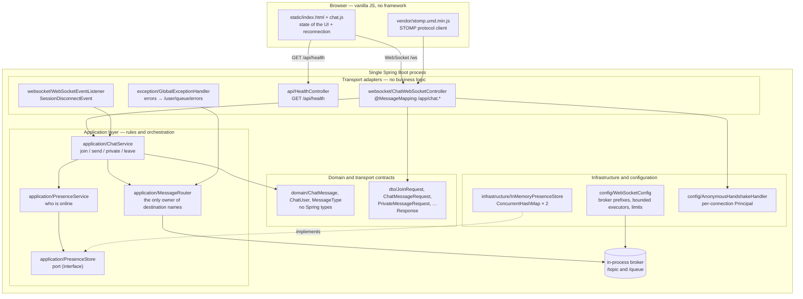

# Architecture — Distributed Chat (MVP 1)

Status of this document: **current behaviour is authoritative**, and every
section about the future is explicitly marked *planned*. Nothing described as
planned exists in the code today.

---

## 1. What exists now

A single Spring Boot process that:

- serves the chat page and its static assets,
- accepts STOMP-over-WebSocket connections at `/ws`,
- holds presence and message routing **in memory**,
- restarts empty: no database, no message history, no clustering.

The original TCP client/server is preserved unchanged under `legacy/tcp/` for
comparison. It is outside the Maven build.

---

## 2. Diagram



**Dependency direction:** adapters → application → domain/DTO. Nothing points
backwards, so `domain/` contains no Spring import, and `ChatService` knows
nothing about HTTP or WebSocket headers.

---

## 3. Layers and their responsibilities

| Layer | Package | Responsible for | Must not do |
|---|---|---|---|
| Transport adapters | `websocket/`, `api/` | Extract session identity, validate payloads, delegate | Contain business rules, decide destinations |
| Application | `application/` | Chat rules, orchestration, presence, routing decisions | Depend on HTTP/WebSocket types, render anything |
| Domain | `domain/` | The concepts: a message, a user, message type | Depend on Spring or on JSON |
| Contracts | `dto/` | Wire shape + declarative validation | Hold rules that need other objects |
| Infrastructure | `infrastructure/` | Concrete implementations of ports | Leak into the application layer |
| Configuration | `config/` | Broker wiring, executors, handshake, CORS | Contain rules |
| Errors | `exception/` | One consistent failure contract per transport | Leak internals or message bodies |

### Separation that matters most

1. **Session management is separate from message routing.**
   `PresenceStore`/`PresenceService` answer "who exists?"; `MessageRouter`
   answers "where does this go?". Neither has to understand the other's job.
2. **`MessageRouter` is the only class that constructs destination strings.**
   It also owns the `/app` and `/user` prefixes, which
   `WebSocketConfig` passes to the broker. This makes one class the source of
   truth for the wire contract, and `FrontendContractTest` checks the browser's
   copy against it.
3. **`PresenceStore` is a port.** `InMemoryPresenceStore` is its only
   implementation. Swapping in Redis later changes one class, not the services.

---

## 4. Endpoints and destinations

### Connection

| Item | Value |
|---|---|
| WebSocket endpoint | `/ws` (native WebSocket, no SockJS) |
| Application prefix | `/app` |
| Broker prefixes | `/topic` (topics), `/queue` (point-to-point) |
| User prefix | `/user` |
| Heartbeats | 10 s out / 10 s in, one daemon scheduler thread |
| Allowed origins | `chat.allowed-origins`, default `http://localhost:8080` and `http://127.0.0.1:8080` — never `*` |

### Client → server (STOMP `SEND`)

| Destination | Payload | Effect |
|---|---|---|
| `/app/chat.join` | `{"username":"alice"}` | Registers this connection under a display name |
| `/app/chat.send` | `{"content":"hello"}` | Broadcasts a public message |
| `/app/chat.private` | `{"recipient":"bob","content":"hi"}` | Delivers to one connection and echoes to the sender |

### Server → client (broadcast or directed)

| Destination | Payload | When |
|---|---|---|
| `/topic/public` | `ChatMessageResponse` | Every public message, and only those |
| `/topic/users` | `UserPresenceResponse` | Any join, leave, or presence change |
| `/user/queue/private` | `ChatMessageResponse` | A private message addressed to this connection |
| `/user/queue/errors` | `ErrorResponse` | A failure caused by *this* connection |

### Message JSON schema

```json
{
  "messageId": "6f0c1b2e-…",
  "type": "CHAT",
  "sender": "alice",
  "recipient": null,
  "content": "hello",
  "timestamp": "2026-10-19T07:52:06.862554700Z"
}
```

`type` is `CHAT` or `PRIVATE`. `recipient` is `null` for `CHAT`. `sender`,
`messageId`, and `timestamp` are **always assigned by the server**.

Presence payload:

```json
{
  "event": "JOIN",
  "username": "alice",
  "users": ["alice", "bob"],
  "timestamp": "2026-10-19T07:52:06.862Z"
}
```

One presence message carries both the cause and the complete sorted list, so a
client cannot be left with a stale list after a lost frame.

### Error codes

| Code | Meaning |
|---|---|
| `INVALID_USERNAME` | Blank, too long, or contains control characters |
| `USERNAME_TAKEN` | Another live connection already holds the name |
| `NOT_JOINED` | A message was sent before joining |
| `INVALID_MESSAGE` | Blank or over 2000 characters |
| `RECIPIENT_NOT_FOUND` | Private target is blank or not connected |
| `INVALID_COMMAND` | The frame is missing something the server needs |
| `INTERNAL_ERROR` | A server bug; details go to the log only |

The code identifies the *concept* that was wrong, whichever layer noticed it:
the validation handler maps the offending field onto the right code, so a bad
username never comes back disguised as a bad message.

---

## 5. Concurrency — stated honestly

Three different claims are often blurred together. Only the first two are true
here.

### 5.1 Concurrent connections — **yes**

Many browsers can hold a socket to this process at once. Nothing in the code
assumes one user at a time; presence is a `ConcurrentHashMap`, not a field.

### 5.2 Multithreaded processing — **yes, bounded**

- STOMP frames arrive on a **bounded inbound pool** (core 4, max 16, queue 500).
- Delivery runs on a **bounded outbound pool** (core 4, max 16, queue 500).
- Both use `CallerRunsPolicy`: when the pool and its queue are both full, the
  caller runs the task itself, which slows the reader down instead of dropping
  work or creating threads without limit.
- **There is no thread-per-message.** A connection does not get a thread for
  each message; tasks are handed to the shared pools.

Configured limits:

| Setting | Default | Purpose |
|---|---|---|
| `chat.inbound.*` | 4 / 16 / 500 | Frame processing capacity |
| `chat.outbound.*` | 4 / 16 / 500 | Delivery capacity |
| `chat.send-time-limit-ms` | 10000 | A send blocked longer than this closes the slow session |
| `chat.send-buffer-limit-bytes` | 524288 | Per-session outbound buffer ceiling |
| `chat.max-inbound-frame-bytes` | 65536 | Transport-level cap on one inbound frame |
| Message length | 2000 chars | Application-level content limit |

A slow client cannot stall the others: it exceeds the time or buffer limit and
is disconnected rather than allowed to hold an outbound thread.

### 5.3 Multi-instance — **no, not today**

All state lives in one JVM. Running a second copy would create two brokers and
two presence stores, and users on one instance would never see users on the
other. See §7.

### 5.4 Why the rules are safe

The only mutable shared state is the presence store, and uniqueness is
enforced by a single **atomic `putIfAbsent`** — not by a lock held across
network I/O:

```java
if (bySession.putIfAbsent(sessionId, user) == null) {
    if (byName.putIfAbsent(nameKey, user) == null) {
        return user;          // exactly one winner
    }
    bySession.remove(sessionId);
}
```

Two threads racing with the same name cannot both succeed: `putIfAbsent` is
atomic in the JDK. No lock is taken anywhere on this path, so a slow client
cannot make another client wait for a presence update. `DuplicateUsernameConcurrencyTest`
releases 32 threads at a time (including a mixed-case variant) and asserts
exactly one registration succeeds.

`ChatService` is stateless; each call works from its arguments. An immutable
`ChatMessage` is safe to hand to several threads when it is delivered to more
than one recipient.

What is **not** claimed: message ordering across the pool is not guaranteed
per session, and the design does not depend on it. Nothing in the rules
requires "message 2 must be processed strictly after message 1".

---

## 6. Security — what the code does, and what it does not

### Implemented

| Requirement | How |
|---|---|
| Server-side validation | Bean Validation on DTOs **and** a re-check in `ChatService` (defence in depth, so a future adapter that skips validation cannot bypass the rules) |
| Message length limit | 2000 chars, enforced in both places, asserted by tests |
| Restricted origins | Explicit allow-list; never `*` |
| Sender cannot be spoofed | `sender` comes from the connection's `Principal`, never from the payload |
| Private messages stay private | Delivered to the recipient and echoed to the sender; never broadcast |
| Private content is not logged | Only lifecycle events are logged (`User 'alice' joined`) |
| Errors are not broadcast | Every error goes to the originating connection's `/user/queue/errors` |
| User content is not markup | `chat.js` renders with `textContent`; a test fails the build if an HTML sink appears |

Origin checking deserves a precise note. Spring's `OriginHandshakeInterceptor`
allows a request when either (a) the `Origin` header matches the request's own
`Host`, or (b) the origin is in the configured allow-list. Observed directly
against a running server:

```
(no Origin header)       -> 101   same-origin / non-browser client
http://localhost:8080    -> 101   on the allow-list
http://localhost:8090    -> 101   same-origin as the Host header
https://evil.example     -> 403   cross-origin and not listed
null                     -> 403   sandboxed / opaque origin
```

So the endpoint cannot be opened from an arbitrary third-party site, while a
page served from the same host:port always works — including when the port is
changed, which needs no configuration change.

### Demo-grade, deliberately

**Joining requires only a username.** There is no password, no token, and no
proof of identity. Anyone who knows another user's name cannot impersonate them
*within* a session, because the name is bound to the connection — but anyone can
*claim* an unused name by joining first. That makes this suitable for a
demonstration of protocol, concurrency and layering, and **unsuitable for
anything real**.

The `AnonymousHandshakeHandler` assigns `anon-<uuid>` as the connection's
`Principal`. It already prefers a real authenticated principal if one exists,
which is the seam where authentication plugs in later without touching the
chat rules.

### Not implemented, and planned

- **Transport security (TLS).** Nothing is encrypted in transit. Terminate TLS
  in front of the process, or enable Tomcat's HTTPS connector.
- **Rate limiting.** Nothing prevents a client from flooding the server with
  frames. Planned: a per-session token bucket on the inbound channel, counting
  frames and bytes before dispatch.
- **Real authentication/authorization.** Username+password or SSO; a signed
  token carried at handshake time; authority mapping for administrative
  actions.
- **Data retention / privacy policy.** Messages are not stored, so there is
  nothing to retain today; once they are stored (§7.5) retention rules become
  necessary.

---

## 7. Path to a distributed deployment

Each item separates **now** from **planned**. Nothing in the planned column is
started.

### 7.1 Load balancer

| Now | Planned |
|---|---|
| One process, addressed directly at `:8080` | HTTP load balancer (nginx / ALB) in front of N instances |
| | The `/ws` upgrade must pass through the balancer's WebSocket support |
| | Health check against `/api/health` |

A load balancer alone is **not sufficient** — see §7.2, because the broker is
in-process.

### 7.2 External message broker

| Now | Planned |
|---|---|
| `enableSimpleBroker("/topic","/queue")` — subscriptions and messages live in this JVM only | Replace with `enableStompBrokerRelay(...)` pointing at RabbitMQ (STOMP plugin) or ActiveMQ |
| A user connected to instance B never receives a message published from instance A | One logical topic shared by all instances, so `*`-broadcasts reach every subscriber |

This is the change that makes horizontal scaling meaningful: without a shared
broker, scaling out silently fragments the chat.

**Why session affinity alone is not enough.** Sticky sessions keep a user's
socket on one instance, which does fix delivery *to that user* if every message
for them is produced by the instance holding their socket. It does not help when
instance A must broadcast to users on instance B. Sticky routing is a
useful adjunct (it keeps user-destination resolution local) but it is not a
substitute for a shared broker. With an external broker there is less need for
affinity, though retaining it keeps `/user/**` translation local and avoids
cross-instance session lookup.

### 7.3 Presence that survives multiple instances

| Now | Planned |
|---|---|
| Two `ConcurrentHashMap`s in one JVM | Presence in a shared store — Redis is the usual fit |
| Name uniqueness by local `putIfAbsent` | Name uniqueness by an atomic cross-instance primitive (`SET NX` with a TTL), so two instances cannot both admit "alice" |
| Lost on restart | Survives restart and is readable by every instance |

Consistency points to settle before this is attempted:

- **Authority.** One store must decide uniqueness, or the race reappears across
  processes. A local check on each instance is not enough.
- **Staleness.** A crashed instance must release its names. Requires a TTL
  refreshed by a heartbeat, or an explicit instance-leaves event that purges
  its registrations.
- **Read-your-writes.** A user who joins should immediately see themselves in
  the list. The join response path should read back from the shared store
  rather than from a local cache.
- **Fan-out of presence events.** `/topic/users` must be published through the
  shared broker, not a local template, or the user list diverges per instance.

### 7.4 Durability, acknowledgements, offline delivery

| Now | Planned |
|---|---|
| No persistence: history exists only in a connected browser tab | Durable message log; STOMP `ACK` frames so delivery is confirmed per message |
| A disconnected user loses everything sent while away | Offline inbox / per-user queue, drained on reconnect |
| No `messageId` deduplication on the client | Client and store both dedupe on `messageId` |
| | Explicit `NACK` + redelivery policy for failed sends |

Message IDs are already server-generated and unique, which is the precondition
for idempotent writes — that part of the groundwork exists.

### 7.5 Persistent storage

| Now | Planned |
|---|---|
| Nothing stored; restart clears everything | Relational store (e.g. PostgreSQL): `users`, `messages`, `sessions` |
| | Message history endpoint (`GET /api/history?since=`) behind authentication |
| | Write path must be idempotent on `messageId` so a redelivery does not duplicate a row |

### 7.6 Authentication and authorization

| Now | Planned |
|---|---|
| Username-only join (demo-grade) | Credentials or SSO; a verified `Principal` established at handshake time |
| | `AnonymousHandshakeHandler` already prefers a real principal — the seam exists |
| | Authorization: who may broadcast, who may read history, rate limits per identity |
| | Rate limiting and payload quotas per identity, not just per connection |

### 7.7 Monitoring and health

| Now | Planned |
|---|---|
| Hand-written `GET /api/health` returning `status`, `onlineUsers`, `timestamp` | Spring Boot Actuator (`/actuator/health`, `/actuator/metrics`) behind auth |
| Broker stats logged once a minute by Spring | Metrics: active sessions, messages in/out, slow-client disconnects, rejection counts by error code |
| | Distributed tracing across instances; alerting on send-limit disconnects |
| | Log redaction policy formalised — today only lifecycle events are logged |

`/api/health` is intentionally tiny so it stays usable as a load-balancer probe.

### 7.8 Horizontal scaling — the order to do it in

1. TLS and real authentication (before exposing anything publicly).
2. External broker (`enableStompBrokerRelay`) — this unblocks scaling.
3. Shared presence with TTL-based expiry.
4. Load balancer; verify WebSocket upgrades pass through.
5. Persistence with idempotent writes.
6. Metrics and alerting.

Doing 4 before 2 produces a cluster that appears to work and silently loses
messages.

---

## 8. Key decisions (ADR style)

| # | Decision | Why |
|---|---|---|
| 1 | Spring Boot 3.5.16, Java 21, Maven wrapper | Current LTS + pinned build tool; wrapper removes the "install Maven first" step |
| 2 | Native WebSocket only, no SockJS | Every target browser supports WebSocket; removing it drops a protocol layer and a dependency |
| 3 | In-process simple broker for MVP | No infrastructure to run; the boundary is one method call (`enableSimpleBroker` → `enableStompBrokerRelay`) |
| 4 | `/queue` is a broker prefix | Spring translates `/user/queue/x` into `/queue/x-user<sessionId>`; without `/queue` in the broker, private messages and errors are undeliverable |
| 5 | Per-connection `Principal` at handshake | Spring only registers a session for `/user/**` delivery when a principal exists; this is also the future authentication seam |
| 6 | Join/leave are presence events, not chat messages | `/topic/public` then carries only `CHAT`, so a client never has to filter system notices out of history, and there is no double broadcast |
| 7 | Presence message carries the full list | A client cannot be left stale by a single lost frame; no delta replay logic |
| 8 | Atomic `putIfAbsent` for uniqueness | Lock-free correctness: no lock is held while anything talks to the network |
| 9 | Bounded pools with `CallerRunsPolicy` | Overload becomes back-pressure instead of unbounded threads or dropped messages |
| 10 | DTO bean validation **and** service re-check | Documented defence in depth; keeps the rules correct if a second adapter is added |
| 11 | Error codes name the concept, not the layer | A bad username must not be reported as a bad message just because the DTO layer caught it |
| 12 | No Spring Security dependency | Nothing to authenticate yet; adding it now would imply guarantees the app does not make |
| 13 | Vendored STOMP JS, no CDN or npm | The demo works offline and needs no build step |
| 14 | `textContent` only, enforced by a test | Prevents a message body from becoming markup in a reader's browser |

---

## 9. Test strategy

| Level | Covers |
|---|---|
| Unit (`ChatServiceTest`) | Every rule: validation, duplicate names, routing decisions, disconnect cleanup, error codes |
| Concurrency (`DuplicateUsernameConcurrencyTest`) | 32 threads racing to claim a name, including mixed case |
| Unit (`InMemoryPresenceStoreTest`) | The port's contract: atomicity, lookup, removal |
| Contract (`FrontendContractTest`) | `chat.js` destinations match `MessageRouter`; no HTML sink in the page script |
| Integration (`ChatWebSocketIntegrationTest`) | Real sockets, 2–3 simultaneous clients: presence, public round trip, private delivery and isolation, spoof resistance, invalid/oversized input, disconnect |
| Integration (`HealthEndpointIntegrationTest`) | The REST surface |

`ChatWebSocketIntegrationTest` contains an explicit **negative** assertion that
a private message is never published to `/topic/public` — a test that would pass
trivially if private routing were accidentally replaced by a broadcast.
